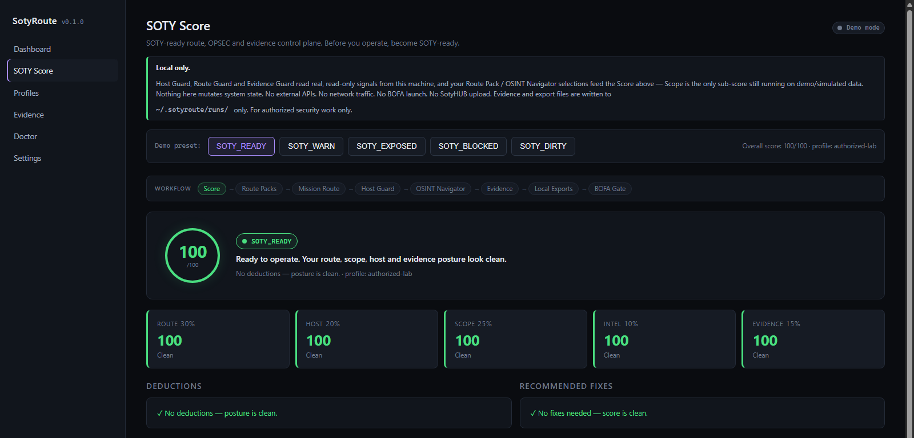
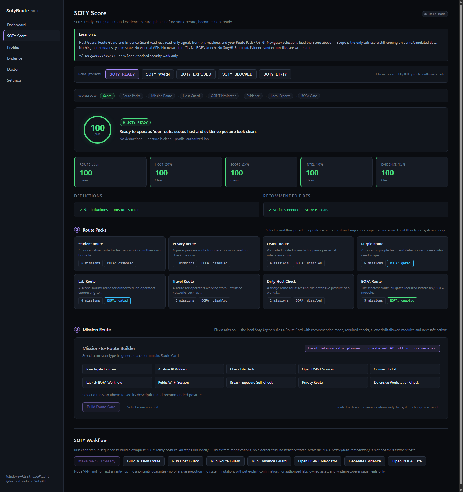
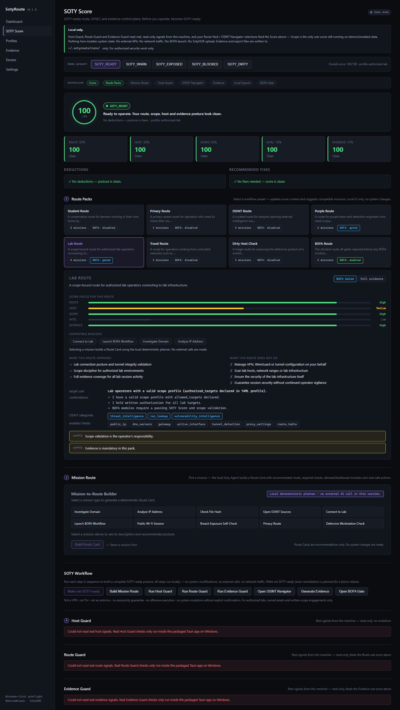
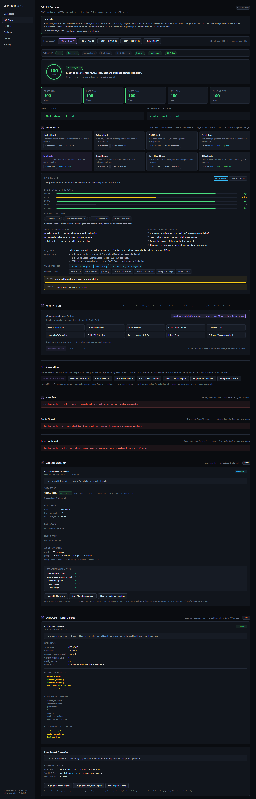
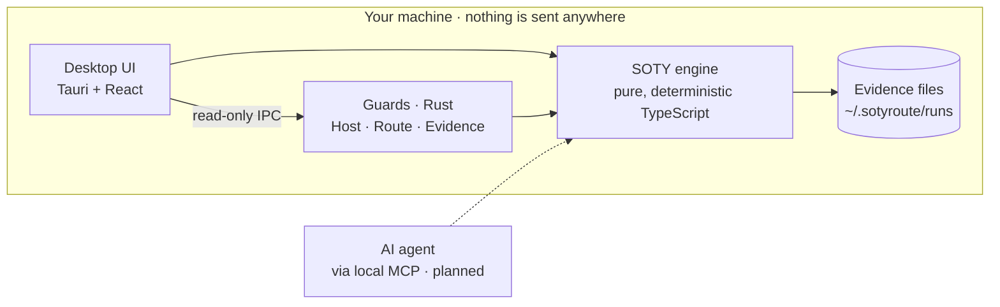

<div align="center">

# SotyRoute

**Preflight & evidence for authorized security work — for humans and AI agents.**

*Before you operate — or before your agent does — become SOTY-ready.*

[](https://github.com/descambiado/SotyRoute/actions/workflows/ci.yml)
[](https://github.com/descambiado/SotyRoute/actions/workflows/audit.yml)
[](LICENSE)
[](#quickstart)
[](https://tauri.app)
[](https://www.rust-lang.org)



</div>

SotyRoute is a **local, explainable preflight** for security work you are authorized to do. It answers one question before anything runs: **are you SOTY-ready?**

Is your route sane? Is your host in a defensible posture? Is your target inside the scope you declared? Is your intel use responsible? Is your evidence ready? You get one score (0–100), every deduction comes with a **reason and a recommended fix**, a session trail lands on disk — and **nothing is sent anywhere**.

> **SOTY** can mean Student, Son or Shooter of the Year — or **Security Operator of the Year**: someone who operates with route, discipline, OPSEC, scope, evidence and technical precision.

Maintained by [@descambiado](https://github.com/descambiado) as part of the **SotyHUB** ecosystem, alongside [BOFA](https://github.com/descambiado/bofa).

## Why it exists

- **Before you operate** — get your posture in order *before* something leaks, not after.
- **Before your agent operates** — AI agents already run security tooling. SotyRoute is being built so an agent can ask the same deterministic questions through a **local MCP server** ([planned](docs/ai-integration.md)).
- **After you operate** — an auditable record (`session.json`, `evidence.md`, `soty_evidence.json`) you can hand to a client or a reviewer.

## What you get

| | |
|---|---|
| **SOTY Score** | One explainable 0–100 score across five weighted sub-scores — Route 30 %, Host 20 %, Scope 25 %, Intel 10 %, Evidence 15 % — and a state: `SOTY_READY`, `SOTY_WARN`, `SOTY_EXPOSED`, `SOTY_DIRTY` or `SOTY_BLOCKED`. |
| **Real, read-only Guards** | **Host Guard** (firewall, Defender, proxy, tunnel processes, elevation), **Route Guard** (DNS, opt-in public IP, tunnel, proxy, route table) and **Evidence Guard** (evidence directory readiness, recorded sessions, export settings). They read; they never change anything. |
| **Route Packs + Soty Agent** | 8 workflow presets (Student, Privacy, OSINT, Purple, Lab, Travel, Dirty Host Check, BOFA) and a deterministic mission-to-route builder that outputs a Route Card. No external AI call. |
| **Ethical OSINT Navigator** | A 35-resource local catalog with risk filters, confirmation gates and blocked-by-policy entries. No scraping, no embedded WebView. |
| **Evidence & exports** | Local evidence snapshots (JSON/Markdown) plus `bofa_export.json` and `sotyhub_export.json`, written to `~/.sotyroute/runs/` only. |
| **BOFA Gate** | A deterministic, local go/no-go decision for BOFA-style workflows. It does not launch BOFA. |
| **Classic mode** | Observe (real, non-destructive) and a dry-run planner for Tor / WireGuard / SOCKS5 / Lab profiles, with YAML/JSON profile validation. |

**Honest status:** the Route, Host, Intel and Evidence sub-scores read real signals. **Scope is still demo-based, by design**, until target declaration lands ([design](docs/soty-scope-architecture.md)). Per-sub-score detail: [docs/soty-score.md](docs/soty-score.md).

## See it

| Score & workflow | Real-signal Guards | Evidence & exports |
|:---:|:---:|:---:|
| [](docs/assets/soty-dashboard.png) | [](docs/assets/soty-score-real-signals.png) | [](docs/assets/soty-evidence-exports.png) |

*Browser-preview captures of the live UI (click to enlarge). In the packaged desktop app the Guard panels show real values from your machine; in a plain browser they fall back gracefully — see [docs/assets/README.md](docs/assets/README.md).*

## Quickstart

**Requirements:** Windows 10/11 x64 · [Node.js](https://nodejs.org/) 20.19+ or 22.12+ · [Rust](https://www.rust-lang.org/tools/install) stable · Microsoft C++ Build Tools · WebView2 (preinstalled on Windows 11).

```powershell
git clone https://github.com/descambiado/SotyRoute.git
cd SotyRoute/apps/desktop
npm install
npm run tauri dev        # full desktop app; the first run compiles the Rust backend
```

- **Just want to look around?** `npm run dev` serves the UI at <http://localhost:1420/#/soty>. Panels that need the Tauri backend (the Guards, Profiles, Settings) show a graceful fallback in a plain browser.
- **Build an installer:** `npm run tauri build` → `apps/desktop/src-tauri/target/release/bundle/msi/`.
- **Releases:** there is no published release yet. The first one will ship an MSI with SHA-256 checksums; the release workflow already builds it on every `v*.*.*` tag.

Then take the guided tour: [docs/demo-walkthrough.md](docs/demo-walkthrough.md) (11 steps).

## Use with AI

SotyRoute never calls an AI: there are **no LLM calls, no external AI APIs and no telemetry**, by design. The integration runs the other way — **your AI agent calls SotyRoute.**

| | Status |
|---|---|
| **Local MCP server** (stdio, read-only tools) so assistants like Claude, Cursor or VS Code can ask for a SOTY Score, a Route Card, a BOFA Gate decision or — once Scope lands — a scope check, *before* they act | **Planned** — [docs/ai-integration.md](docs/ai-integration.md) |
| **AI-friendly repo:** [`AGENTS.md`](AGENTS.md) (build, test, safety rules, conventions) and [`llms.txt`](llms.txt) (documentation map) | **Available** |
| **Machine-readable outputs:** `soty_evidence.json`, `bofa_export.json` and `sotyhub_export.json` are plain JSON | **Available** |

> **Advisory, not enforcement.** A tool an agent *chooses* to call can inform its decisions; it cannot stop it from acting. "In scope" means "inside the lists *you* declared" — SotyRoute cannot verify real-world authorization.

## How it works



The UI never runs elevated, the Guards only read, and the scoring engine is pure functions with no I/O. More in [docs/architecture.md](docs/architecture.md).

## Safety model

- The UI never runs as administrator; the Guards only **read** system state.
- **No telemetry and no background network traffic.** The only outbound requests are explicit and operator-initiated: an opt-in public-IP lookup (off by default) and a TCP connect probe command that is not exposed in the UI yet.
- Evidence and export files are written **only** to `%USERPROFILE%\.sotyroute\runs\`.
- Anything that could mutate the system is dry-run first; fail-closed is the design goal.
- Scope is **operator-declared and advisory**: SotyRoute checks your declared allow/block lists and does not probe targets.

**What SotyRoute is not:** a VPN provider (no servers) · Tor · an anonymity guarantee · an antivirus or EDR · a BOFA launcher · a SotyHUB uploader · a scraper · an offensive tool. It does not mutate system settings or network configuration in the current release.

For **authorized labs, owned assets, defensive research and written-scope engagements only** — see [docs/legal-scope.md](docs/legal-scope.md) and [docs/threat-model.md](docs/threat-model.md).

## Documentation

Everything is indexed in **[docs/README.md](docs/README.md)**. Good starting points:

| Read | If you want to |
|---|---|
| [Demo walkthrough](docs/demo-walkthrough.md) | try the SOTY dashboard end to end |
| [SOTY Score](docs/soty-score.md) | understand every sub-score, deduction and state |
| [Architecture](docs/architecture.md) · [Threat model](docs/threat-model.md) | see how it is built and what it does *not* protect against |
| [AI & MCP integration](docs/ai-integration.md) | plug SotyRoute into an AI agent (planned) |
| [Comparison](docs/comparison.md) | see how it differs from a VPN, Nipe, proxychains or manual setup |
| [Roadmap](docs/roadmap.md) · [Changelog](CHANGELOG.md) | see what is shipped and what is next |

## Contributing & community

Contributions follow the same standards as the tool: read [CONTRIBUTING.md](CONTRIBUTING.md) and [AGENTS.md](AGENTS.md) first. Ideas and questions are welcome in [Discussions](https://github.com/descambiado/SotyRoute/discussions); bugs and feature requests go to [Issues](https://github.com/descambiado/SotyRoute/issues); vulnerabilities go through [private security advisories](SECURITY.md). Please follow the [Code of Conduct](CODE_OF_CONDUCT.md).

## License

MIT — see [LICENSE](LICENSE).
